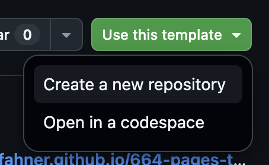

# Python Project Template

This repository is a template for publishing a Python project as a website using **GitHub Pages**. The page you're reading right now is the site's home page — it's just the `README.md` file from the repo, turned into a web page.

Everything here is plain Markdown. GitHub pages renders markdown as HTML so it is viewable in the browser.

## Pages in This Site

This home page links to two other Markdown files in the repo. Click them to see linking in action:

- [Markdown examples](about.md) — an example page with embedded tables and images
- [Code examples](embedding-code.md) — an example page with code examples (both as static markdown and as interactive [pyodide](https://pyodide.org/en/stable/) snippets)
- [A JupyterLite notebook](notebook/notebooks/index.html?path=week10.ipynb) hosted on your GitHub pages site, which can run in the browser without your viewers needing to have Jupyter Lab/Anaconda etc installed

Each of those pages links back here and to each other. You can open them on GitHub.com *and* on the published site — the same links work in both places.

## How It Works

- GitHub Pages runs a tool called [Jekyll](https://jekyllrb.com/) on your repo automatically every time you push. It converts each `.md` file into an `.html` page.
- **`README.md` is the home page.** If there's no `index.md` in the repo, GitHub Pages uses `README.md` as the landing page.
- **Linking between pages is just a normal Markdown link.** Write `[About the Project](about.md)` and GitHub Pages rewrites it to `about.html` when it builds the site. Because the link points to the `.md` file, it also works when browsing the repo on GitHub.com.
- **No front matter required.** You don't need the `---` block some Jekyll tutorials show at the top of each file. Each page's first `# Heading` is used as its title.
- **`_config.yml` controls site-wide settings.** In this repo it only sets the site title, description, and theme. Try changing the `theme:` line to another [supported theme](https://docs.github.com/en/pages/setting-up-a-github-pages-site-with-jekyll/adding-a-theme-to-your-github-pages-site-using-jekyll/) such as `jekyll-theme-cayman`.

## Publishing Your Site on GitHub.com

1. **Make your own copy.** [Navigate to this repo on github.com.](https://github.com/craigfahner/664-pages-template). Click **Use this template → Create a new repository** at the top of this repo on GitHub.com (or fork it). Give the repository a name; it will become part of your site's URL.

2. **Turn on GitHub Pages.** In your new repo, go to **Settings → Pages**. Under **Build and deployment**, set **Source** to **GitHub Actions**. (The workflow in `.github/workflows/pages.yml` builds the site, including the JupyterLite notebook. If its first run failed because Pages wasn't turned on yet, open the **Actions** tab and re-run it.)
3. **Wait for the build.** Open the **Actions** tab to watch the "Build and deploy site" workflow. It usually takes a few minutes.
4. **Visit your site.** It will be at:

   ```
   https://YOUR-USERNAME.github.io/YOUR-REPO-NAME/
   ```

   The link also appears at the top of **Settings → Pages** once the site is live.
5. **Edit and push.** Any change pushed to `main`, including edits made directly on GitHub.com with the pencil icon, rebuilds the site automatically.

## Adding a New Page

1. Create a new file ending in `.md`, for example `gallery.md`.
2. Start it with a heading: `# Gallery`.
3. Link to it from this README: `[Gallery](gallery.md)`.
4. Commit and push. The new page appears on the site after the next build.

## Troubleshooting

- **404 on the site?** Make sure Pages is enabled (step 2 above) and the build in the **Actions** tab finished with a green check.
- **A link is broken?** Check the filename's spelling and capitalization. `About.md` and `about.md` are different files.
- **Changes aren't showing?** Wait for the build to finish, then hard-refresh your browser (Shift + Reload).
