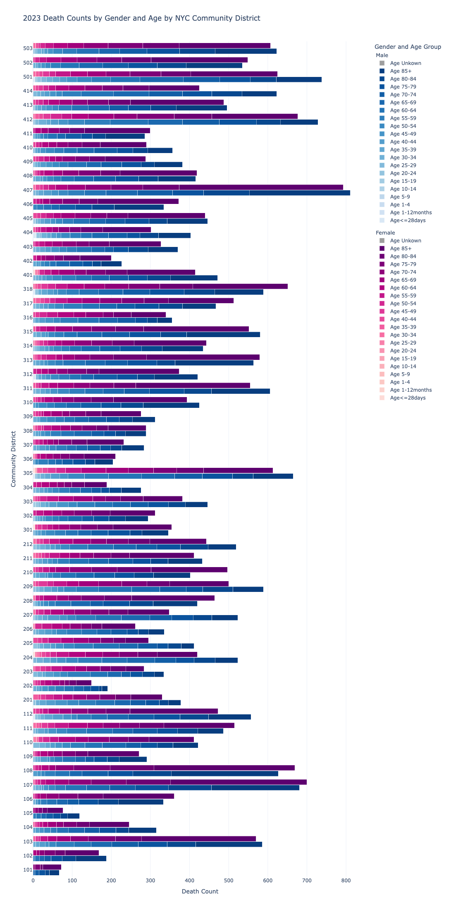
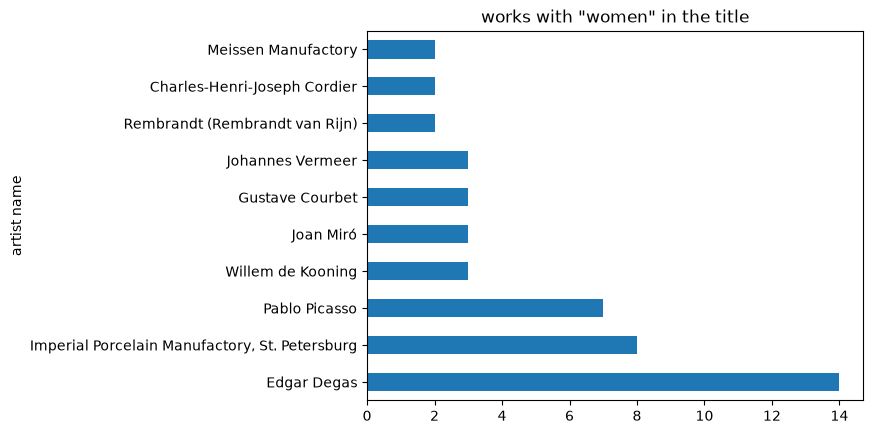

# Community District Death Counts and Rates Demographics 

[← Back to home](README.md)

### Images

To add an image, put the image file in the repo and link to it with an exclamation mark in front:

```markdown

``` lican voter intention](average-senate-polling-late-october-nov.png)


*Average US Senate polling by state, late October to November 2.*

The text in the square brackets is the **alt text**.

Markdown images always fill the width of the page. To choose a size, use an HTML `` tag instead. This works on GitHub.com and on the published site:

```html

```


*Artists with the most works with "women" in the title.*

### Tables

Markdown tables use `|` to separate columns, and a row of dashes under the header row. Add a `:` on the right side of the dashes to right-align a column, which makes numbers easier to compare:

```markdown
|       | objectID  | isHighlight |
| ----- | --------: | ----------: |
| count | 492.00    | 492.00      |
| mean  | 338124.42 | 0.08        |
```

Here's a full example: 

|       | objectID  | isHighlight | accessionYear | isPublicDomain | objectBeginDate | objectEndDate | county | isTimelineWork |
| ----- | --------: | ----------: | ------------: | -------------: | --------------: | ------------: | -----: | -------------: |
| count | 492.00    | 492.00      | 489.00        | 492.00         | 492.00          | 492.00        | 0.00   | 492.00         |
| mean  | 338124.42 | 0.08        | 1935.58       | 0.85           | 25.12           | 117.55        | NaN    | 0.13           |
| std   | 150547.31 | 0.26        | 37.74         | 0.36           | 1319.63         | 1242.36       | NaN    | 0.33           |
| min   | 10112.00  | 0.00        | 1871.00       | 0.00           | -7000.00        | -4000.00      | NaN    | 0.00           |
| 25%   | 247556.75 | 0.00        | 1910.00       | 1.00           | -550.00         | -485.00       | NaN    | 0.00           |
| 50%   | 253507.00 | 0.00        | 1926.00       | 1.00           | -299.00         | -200.00       | NaN    | 0.00           |
| 75%   | 469534.00 | 0.00        | 1966.00       | 1.00           | 1539.50         | 1547.00       | NaN    | 0.00           |
| max   | 897321.00 | 1.00        | 2023.00       | 1.00           | 2005.00         | 2005.00       | NaN    | 1.00           |

**Tip:** You don't have to type tables by hand. pandas can write a Markdown table for you. Run this in your notebook and paste the result into your page:

```python
print(df.describe().round(2).to_markdown())
```

(`to_markdown()` needs the `tabulate` package: `conda install tabulate`.)


---

Next: [Code Examples →](embedding-code.md)
