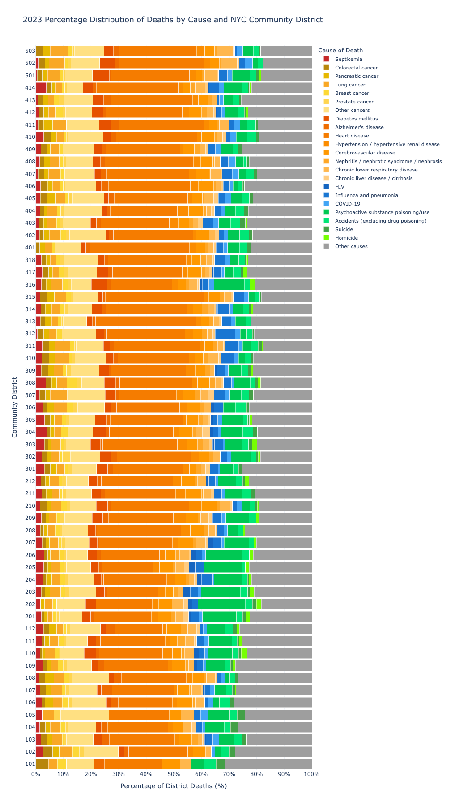
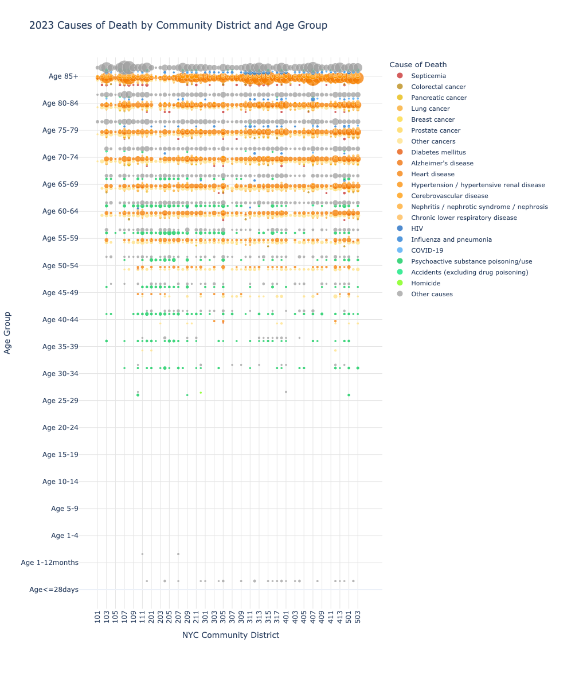

# Community District Death Counts and Rates Demographics 

[← Back to home](README.md)

## Gender and Age Distribution by Community District
Description 

<p align="center">
  
</p>

---

## Distribution of Cause of Death
Description
<p align="center">
  
</p>
  

## Cause of Death by Community District: Scatter Plot
Description 
<p align="center">
  
</p>


### Tables

## NYC Cause of Death Statistics  

|                                      |   Districts with Data |   Mean |   Standard Deviation |   Minimum |     Q1 |    Q2 |    Q3 |   Maximum |   Total Deaths |   Median |   Variance |   Skewness |   Kurtosis |   Range |    IQR |
|:-------------------------------------|----------------------:|-------:|---------------------:|----------:|-------:|------:|------:|----------:|---------------:|---------:|-----------:|-----------:|-----------:|--------:|-------:|
| Heart disease                        |                    59 | 226    |               100.1  |        32 | 154    | 219   | 288   |       481 |          13334 |    219   |   10019.4  |       0.36 |      -0.33 |     449 | 134    |
| Other causes                         |                    59 | 188.63 |                71.41 |        48 | 142    | 180   | 225.5 |       384 |          11129 |    180   |    5099.44 |       0.44 |       0.33 |     336 |  83.5  |
| Cancer                               |                    59 | 168.03 |                66.5  |        32 | 128    | 154   | 201   |       335 |           9914 |    154   |    4421.79 |       0.6  |       0.17 |     303 |  73    |
| Psychoactive substance poisoning/use |                    59 |  45.68 |                26.36 |         7 |  25    |  38   |  66.5 |        99 |           2695 |     38   |     694.64 |       0.64 |      -0.8  |      92 |  41.5  |
| Cerebrovascular disease              |                    59 |  34.53 |                14.22 |         9 |  23.5  |  32   |  44   |        79 |           2037 |     32   |     202.15 |       0.68 |       0.39 |      70 |  20.5  |
| Lung cancer                          |                    59 |  29.68 |                15.2  |         5 |  21    |  25   |  32.5 |        80 |           1751 |     25   |     230.95 |       1.48 |       2.24 |      75 |  11.5  |
| Diabetes mellitus                    |                    57 |  27.28 |                14.01 |         5 |  20    |  24   |  32   |        83 |           1555 |     24   |     196.24 |       1.6  |       3.97 |      78 |  12    |
| Chronic lower respiratory disease    |                    59 |  23.8  |                14.04 |         6 |  13.5  |  20   |  30   |        72 |           1404 |     20   |     197.2  |       1.61 |       2.77 |      66 |  16.5  |
| Influenza and pneumonia              |                    57 |  23.79 |                13.07 |         5 |  15    |  21   |  28   |        59 |           1356 |     21   |     170.85 |       1.09 |       0.85 |      54 |  13    |
| Accidents                            |                    59 |  20.08 |                 7.84 |         6 |  15    |  19   |  25   |        48 |           1185 |     19   |      61.39 |       0.75 |       1.38 |      42 |  10    |
| Hypertension                         |                    57 |  20.51 |                 9.41 |         5 |  15    |  19   |  25   |        50 |           1169 |     19   |      88.5  |       0.85 |       0.74 |      45 |  10    |
| Septicemia                           |                    56 |  16.71 |                 7.75 |         5 |  12    |  15.5 |  21   |        42 |            936 |     15.5 |      60.14 |       1.04 |       2.1  |      37 |   9    |
| Pancreatic cancer                    |                    57 |  16.39 |                 7.83 |         5 |  10    |  15   |  20   |        42 |            934 |     15   |      61.28 |       1    |       0.81 |      37 |  10    |
| Colorectal cancer                    |                    57 |  16.23 |                 7.34 |         5 |  11    |  14   |  21   |        32 |            925 |     14   |      53.86 |       0.5  |      -0.84 |      27 |  10    |
| Alzheimer's disease                  |                    57 |  14.39 |                 9.03 |         5 |   9    |  13   |  17   |        54 |            820 |     13   |      81.56 |       2.17 |       6.23 |      49 |   8    |
| COVID-19                             |                    55 |  14.11 |                 7.18 |         5 |   9    |  13   |  19   |        38 |            776 |     13   |      51.51 |       0.96 |       1.15 |      33 |  10    |
| Breast cancer                        |                    56 |  13.21 |                 5.45 |         5 |   9.75 |  12   |  17   |        36 |            740 |     12   |      29.74 |       1.44 |       4.07 |      31 |   7.25 |
| Nephritis                            |                    53 |  12.77 |                 6.28 |         5 |   8    |  12   |  15   |        30 |            677 |     12   |      39.49 |       1.14 |       0.72 |      25 |   7    |
| Prostate cancer                      |                    51 |  10    |                 4.14 |         5 |   7    |   9   |  12   |        21 |            510 |      9   |      17.12 |       0.96 |       0.1  |      16 |   5    |
| Suicide                              |                    51 |   8.88 |                 3.8  |         5 |   6    |   8   |  11   |        19 |            453 |      8   |      14.47 |       1.06 |       0.33 |      14 |   5    |
| Chronic liver disease                |                    45 |   9.36 |                 2.69 |         5 |   7    |   9   |  11   |        15 |            421 |      9   |       7.23 |       0.31 |      -0.56 |      10 |   4    |
| Homicide                             |                    30 |   9.07 |                 3.48 |         5 |   6    |   9   |  11   |        18 |            272 |      9   |      12.13 |       0.6  |      -0.1  |      13 |   5    |
| HIV                                  |                    23 |   8.74 |                 4.27 |         5 |   5    |   7   |  11   |        17 |            201 |      7   |      18.2  |       0.91 |      -0.63 |      12 |   6    |


**Tip:** You don't have to type tables by hand. pandas can write a Markdown table for you. Run this in your notebook and paste the result into your page:

```python
print(df.describe().round(2).to_markdown())
```

(`to_markdown()` needs the `tabulate` package: `conda install tabulate`.)


---

Next: [Code Examples →](embedding-code.md)
